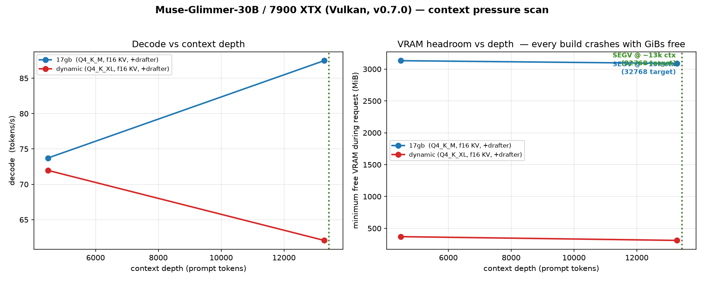

# Muse-Glimmer-30B on the 7900 XTX — context pressure scan (the 21.6k crash)

**Date:** 2026-10-16 · **Card:** 7900 XTX (Vulkan/RADV, Mesa 26.2.3) · **Image:** `llama-vulkan:v0.7.0`
**Runner:** [`ctx_pressure.py`](../../../.tmp/muse/ctx_pressure.py) — samples free VRAM every 50 ms
*throughout* each request and reports the minimum, so a transient peak allocation cannot hide.

## Headline

**The model crashes with a SIGSEGV at ~21.6k prompt tokens, and it is not a memory problem.**
Reproduced with three different configurations, two of which had **GiBs** of VRAM free:

| configuration | free VRAM | ~24k prompt | result |
|---|---|---|---|
| 17gb + drafter, f16 KV | 3244 MiB | ❌ | **SIGSEGV, exit 139** |
| **dynamic** + drafter, f16 KV | 481 MiB | ❌ | **SIGSEGV, exit 139** |
| **17gb, NO drafter**, f16 KV | **5641 MiB** | ❌ | **SIGSEGV, exit 139** |

**5.6 GiB free and it still dies.** That rules out VRAM exhaustion, the dynamic build, and the
drafter as causes.

## Boundary

Bisected with a clean cache (the scan reuses a server-side prefix, so a "depth" request can
report a much smaller `prompt_n` — two early points were invalidated by that and re-run):

| prompt tokens | result | decode |
|---|---|---|
| 4485 | ✅ | 71.97 |
| 13278 | ✅ | 62.07 |
| 16253 | ✅ | 54.57 |
| 19491 | ✅ | 62.02 |
| 21648 | ✅ | 41.17 |
| **~22000** | ❌ **SIGSEGV** | — |
| 32768 | ❌ SIGSEGV | — |

**Usable context ≈ 21.6k tokens — about 16 % of the model's declared 131072.**

The failure is not graceful: the server **exits 139** rather than returning an error. In one
of the four crashes the process survived the request and died later; the rest died on the
request itself. Either way it is a crash, not a rejection.

## The plot

The right panel is the point: every series stops with thousands of MiB still free. Decode is
flat-to-rising up to the boundary (17gb actually *rises* 73.7 → 87.5 t/s), so this is not the
gradual memory-pressure cliff documented for this card in September — it is a hard stop.

## Why this did not appear in the agentic batteries

Every prior agent run stayed clear of the boundary, and that is verifiable:

| task | max single-request prompt (run #1 / #2) | boundary |
|---|---|---|
| A1 | 12844 / 12845 | ~21600 |
| A2 | 9243 | ~21600 |
| A3 | 20515 / **20579** | ~21600 |

An earlier claim of mine — that A1's *aggregate* 42406 tokens exceeded the boundary — **was a
misread**: that figure is the sum over all requests in the task, not one request. Aggregates
must never be compared against a single-request limit.

**A3 at 20579 is the real warning**: it reached ~95 % of the boundary. A slightly longer agent
trajectory would have crashed it.

## What this is not

- **Not dynamic-specific.** Same boundary on 17gb.
- **Not drafter-specific.** Same boundary with `--spec-type` absent entirely.
- **Not a VRAM wall.** Crashes with 5641 MiB free.
- **Not the September cliff.** That one was a 3.4× decode collapse with ~200 MiB free; this is
  a SIGSEGV with GiBs free, at a specific prompt size.

## Open question

The mechanism is unidentified. Candidates not yet excluded:

1. a graph/buffer allocation path that scales with **ubatch** and overflows at a specific size
2. an interaction between this model's **sliding-window attention** (39 of 52 layers) and the
   Vulkan FA kernel at longer sequences — the model declares SWA, which is exactly the
   precondition for the sparse-FA path merged in b10982
3. something in the **vision projector** path, since mmproj is loaded in every crashing config

Testable next: `-ub` variation to test (1); `GGML_VK_FA_SPARSE_DISABLE=1` to test (2); and a
load without mmproj to test (3). All three are single-variable and cheap.

**This is worth an upstream report** — it is deterministic, minimal, and lands on a documented
model/backend combination.

## Honest boundaries

1. **One card, one backend.** Not tested on SYCL or on the B70.
2. **The filler is synthetic** (~1.6 chars/token of repeated Chinese words). Real prose may
   tokenize differently, so the boundary in *tokens* is the transferable number, not the
   character count.
3. **`n_ubatch` was not recorded** — the log did not print it at the verbosity used, so the
   graph-buffer hypothesis is untested.
4. Points were re-run where the server-side prefix cache made a nominal depth actually much
   shallower; the table above is post-correction.
